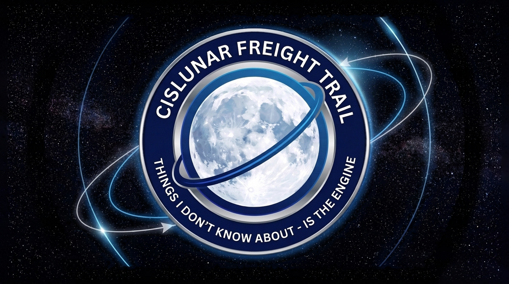

> This solution was developed as part of NASA Space Apps Tel Aviv 2026. The event was led by the Space Engineering Center (SEC) and SpaceTAU at Tel Aviv University, in partnership with the Rakia Mission and Space Campus IL.

# Lighthouse on the Trail — Space Mission Design Game

**NASA Space Apps Challenge 2026 · Challenge: _Space Mission Design Game_ · Team eleven-two**

▶ **Play it:** https://gennady73.github.io/space-mission-simulator/
📊 **Every number and its source:** https://gennady73.github.io/space-mission-simulator/#about



## What it is

Design a robotic outpost at the Moon's south pole the way NASA designs missions, then fly it for a year.

1. **Think first.** Each stage opens with a question, for example *why are there craters that never see the Sun right next to peaks that almost always do?* You write your hypothesis, then the game explains.
2. **Design.** Choose a landing site, launcher, trajectory, landing pad, power mast, batteries, communications, data storage, cold-trap logistics, a power link and science instruments. A resource bar shows **mass, power, budget, data, communications and time** after every choice.
3. **Pass the reviews.** Your design must clear NASA-style gates, each checking a real constraint:
   - **MCR:** landing slope and Earth visibility.
   - **SRR:** rocket-plume standoff, and wet mass against the launcher.
   - **PDR:** battery margin through the longest shadow, using the **GSFC-STD-1000 Rule 1.06** 15% margin.
   - **CDR:** cold-trap heater, route slope and power-link range.

   A failed review names the check, the cause and what to change.
4. **Fly the year.** A deterministic, hour-by-hour simulation of 8,760 hours covers sunlight and shadows, battery charge, Earth line of sight, data buffering and water-ice extraction, with seeded random events (dust, cable snags, rover wear).
5. **Debrief.** You get a score, telemetry charts, the events of the year, what failed and why, and badges linked to NASA's FY26 technology shortfalls. Then revise and fly again. Several different designs succeed, and none is perfect at everything.

**Play alone, or as a team of up to four** on one screen. Each seat owns one NASA mission segment (User, Launch, Space, Ground), makes only its own decisions and signs off its own review, while everyone shares one budget and one mass limit. Three difficulty levels: Cadet, Engineer and Flight Director. Designs can be exported or shared by link.

Optional *"Want to know more?"* side-quests at SRR, PDR and CDR let players do the engineers' arithmetic (battery sizing, the margin rule, buffer size, laser power, plume standoff), with answers checked on the spot.

## Why it is credible

- **Every number lives in one file,** [`public/config/engine-constants.json`](public/config/engine-constants.json), with its source and a tier: NASA document, physical constant, literature, provisional, or game rule. The *About & Numbers* page lists all 246.
- **A test fails the build if any number lacks a source.** Values we invented to make the game work are labelled *game rule* and never presented as NASA values.
- **NASA citations were checked against the documents.** The PDR margins come from GSFC-STD-1000 Rule 1.06; the shortfall IDs, ranks and need numbers come from the FY26 STMD prioritisation.
- **The page says what the model leaves out:** synthetic Sun/Earth positions instead of ephemerides, no orbit integration, and threshold thermal checks.

## Run it locally

```bash
npm install
npm run dev          # http://localhost:5173
npm test             # unit tests (engine, margins, provenance, side-quests)
npm run test:e2e     # browser tests (first time: npx playwright install chromium)
npm run build        # static site in dist/
```

Every merge to `main` builds, tests and deploys to GitHub Pages (`.github/workflows/deploy.yml`).

## How it is built

- TypeScript and Vite, with no UI framework and no server; it runs offline once loaded.
- `src/engine/` is pure and deterministic: constants loader, subsystem models, stage gates, the 8,760 h clock and scoring.
- `src/ui/` holds the cockpit, debrief, telemetry charts, hypothesis cards, side-quests and the About & Numbers page.
- Design documents are in `docs/`: [`BUILD-PLAN.md`](docs/BUILD-PLAN.md) (scope, spec errata, engine↔UI contract) and `docs/team/context/` (state, decision log, handovers).

## NASA documents and data

Used in this build:
- *Design and Develop Science Missions* (NASA, challenge resources): the four mission segments that structure the game.
- **GSFC-STD-1000 Rev I**, Rule 1.06 Resource Margins (NASA Goddard).
- **FY26 Civil Space Shortfall Prioritization** (NASA STMD).
- Vertical Solar Array Technology, NASA TechPort project 116305.
- NASA Systems Engineering Handbook (SP-2016-6105 Rev 2) and NPR 7120.5: life-cycle phases and reviews.
- CubeSat 101 (NASA CSLI).

NASA datasets in this build (processed by `tools/data-pipeline/` into `public/data/`, ≤4 MB of JSON; the map names its sources on screen):
- **LOLA 120 m polar DEM** (LDEM_75S_120M, LRO LOLA GDR; NASA PDS Geosciences) — the map's regional terrain and 120 m site close-ups.
- **LOLA 5 m/px site DEMs** (NASA PGDA product 78; Barker et al. 2021) — terrain within 4 km of three landing sites.
- **LRO Diviner South Polar Resource Product v2** (NASA PDS; D. A. Paige, UCLA) — cold-trap temperatures and depth to stable ice; the 110 K surface-ice limit follows Paige et al. 2010.
- **Lunar Polar Illumination, PGDA product 69** (Mazarico et al. 2011) — 60 m permanent-shadow maps, plus sunlight and Earth-visibility cross-checks of the site catalog.

## Use of AI

- The game specification was drafted with Google Gemini (NotebookLM) from the NASA materials above.
- Code, the constants file, tests and documentation were written with Anthropic Claude: each team member worked with their own Claude session, and every change was reviewed, tested and merged by the team.
- Every AI-produced number is tiered on the About & Numbers page, and the NASA citations were checked against the source documents.

## Team

eleven-two
